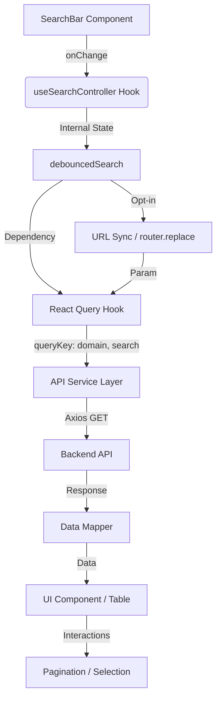

# Sprint 19 — Unified Search Architecture Blueprint

## Executive Summary
This document defines the architectural blueprint for **ONE standardized Search Architecture** across the CRM frontend, introducing the `useSearchController` hook and defining the complete search pipeline state machine.

---

## Unified Data Flow Pipeline

---

## Search State Machine

Every search interaction across the CRM follows this identical state machine:

1. **Idle**: Empty input, no active search.
2. **Typing**: User is actively typing (triggers `isSearching: true`, cancels pending debounces).
3. **Debouncing**: User stopped typing, waiting for the 300ms threshold.
4. **Loading**: Debounce hit, React Query `isFetching: true`.
5. **Success**: Results returned > 0.
6. **Empty**: Results returned = 0.
7. **Error**: API failure (triggers retry logic or error UI).

---

## Architectural Principles & Ownership Rules

1. **Separation of Concerns**: `useSearchController` owns state and debouncing, but **does not force URL synchronization**. The consumer page decides whether to sync to URL (e.g., Lead Directory = YES, Global Modal = NO).
2. **Unified Debounce Strategy**: Standard 300ms delay provided by `useDebounce` internally.
3. **Reactive React Query Refetching**: Search terms are strictly included inside React Query keys (`queryKey`).
